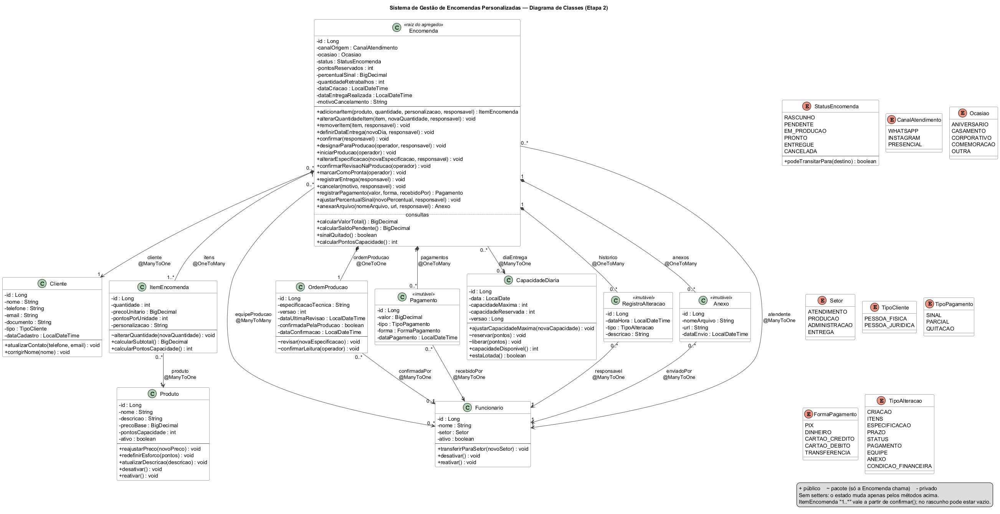

# Gestão de Encomendas Personalizadas

Back-end de um sistema interno para uma pequena empresa de produtos personalizados sob encomenda
(8 colaboradores; pedidos chegando por WhatsApp, Instagram e presencialmente).

**Disciplina:** Projeto de Back-End Avançado — Prof. Jonas
**Etapa:** 2ª entrega — modelagem do domínio e definição da arquitetura
**Equipe:** Thiago ([thiagoapa](https://github.com/thiagoapa)) · Tales Vitor ([TalesVitor](https://github.com/TalesVitor))

---

## 1. O problema (resumo da Etapa 1)

A empresa não tem uma fonte única de informação sobre cada encomenda. Isso causa:

- **Alterações que não chegam à produção:** o cliente muda o pedido, o atendimento aceita, a produção faz com a informação antiga → retrabalho e desperdício.
- **Prazos prometidos sem olhar a agenda:** datas são combinadas "de cabeça" e a capacidade de produção já estava tomada.
- **Pagamentos sem controle:** produção iniciada sem sinal e entregas feitas sem receber o saldo.
- **Ninguém sabe o status real:** o atendente precisa perguntar a outras pessoas para responder ao cliente.

**Prioridade escolhida:** gestão centralizada do pedido e rastreabilidade do seu ciclo de vida.

**Fora do MVP:** integração com WhatsApp/Instagram, estoque e compras de materiais, nota fiscal, chatbot.

## 2. Como o modelo resolve cada problema

| Problema | Onde está a regra no código |
|---|---|
| Alteração não chega à produção | `Encomenda.alterarEspecificacao()` cria nova versão da `OrdemProducao` e exige que a produção confirme a leitura. `marcarComoPronta()` é **bloqueado** enquanto a revisão não for confirmada. Se a peça já estava pronta, volta para produção e conta um retrabalho. |
| Prazo em dia lotado | `CapacidadeDiaria` guarda quanto a equipe aguenta por dia. `Encomenda.confirmar()` reserva os pontos de esforço dos itens e **recusa** se o dia estiver cheio. `@Version` evita que dois atendentes reservem a última vaga ao mesmo tempo. |
| Produção sem sinal | `iniciarProducao()` só passa se `sinalQuitado()` (padrão 50%). A administração pode mudar o percentual por encomenda (ex.: cliente corporativo faturado) com `ajustarPercentualSinal()`. |
| Entrega sem receber | `registrarEntrega()` é **bloqueado** enquanto houver saldo pendente. |
| Ninguém sabe o status | Status único (`StatusEncomenda`) com transições validadas, e trilha de auditoria (`RegistroAlteracao`) com quem mudou o quê e quando. |
| Quais encomendas dão retrabalho/lucro | `quantidadeRetrabalhos`, preço congelado no item (`precoUnitario`) e todos os pagamentos ligados à encomenda — base para relatórios na próxima etapa. |

### Ciclo de vida da encomenda

```
RASCUNHO ──confirmar──▶ PENDENTE ──iniciarProducao──▶ EM_PRODUCAO ──marcarComoPronta──▶ PRONTO ──registrarEntrega──▶ ENTREGUE
                                                           ▲                                │
                                                           └──── alterarEspecificacao ──────┘  (retrabalho)

Qualquer estado, exceto ENTREGUE ──cancelar──▶ CANCELADA  (devolve a capacidade reservada)
```

## 3. Modelo de domínio

### Diagrama de classes



Arquivos: [`docs/diagrama-classes.png`](docs/diagrama-classes.png) · [`docs/diagrama-classes.svg`](docs/diagrama-classes.svg) · fonte PlantUML [`docs/diagrama-classes.puml`](docs/diagrama-classes.puml)

### Entidades

| Entidade | Papel |
|---|---|
| `Encomenda` | Raiz do agregado. Único ponto por onde itens, pagamentos, anexos, histórico e ordem de produção mudam. |
| `Cliente` | Quem encomenda (pessoa física ou jurídica). |
| `Funcionario` | Colaborador, com setor (atendimento, produção, administração, entrega). Responsável em toda alteração. |
| `Produto` | Catálogo, com preço base e esforço de produção ("pontos de capacidade" por unidade). |
| `ItemEncomenda` | Produto + quantidade + personalização. Congela preço e esforço do momento da venda. |
| `OrdemProducao` | Ficha técnica que a produção usa, com versão e confirmação de leitura. |
| `CapacidadeDiaria` | Agenda de um dia: capacidade máxima e quanto já foi reservado. |
| `Pagamento` | Valor recebido; tipo (sinal/parcial/quitação) decidido pela encomenda. Imutável. |
| `RegistroAlteracao` | Trilha de auditoria. Imutável. |
| `Anexo` | Link para arte/referência enviada pelo cliente. Imutável. |

### Relacionamentos JPA

| Relação | Mapeamento | Por quê |
|---|---|---|
| Encomenda N — 1 Cliente | `@ManyToOne` | Unidirecional de propósito: o módulo `cliente` não depende do módulo `encomenda` (sem dependência circular). Os pedidos de um cliente serão buscados pelo repositório. |
| Encomenda N — 1 Funcionario (atendente) | `@ManyToOne` | Quem abriu o pedido. |
| Encomenda N — N Funcionario (equipe de produção) | `@ManyToMany` + `@JoinTable encomenda_equipe_producao` | Uma encomenda pode ter várias pessoas produzindo; cada pessoa trabalha em várias encomendas. |
| Encomenda 1 — 1 OrdemProducao | `@OneToOne(cascade = ALL, orphanRemoval)` | Cada encomenda tem exatamente uma ficha de produção vigente. |
| Encomenda 1 — N ItemEncomenda / Pagamento / RegistroAlteracao / Anexo | `@OneToMany(mappedBy, cascade = ALL)` | Composição: só existem dentro da encomenda. |
| Encomenda N — 1 CapacidadeDiaria | `@ManyToOne` | Vários pedidos dividem a capacidade do mesmo dia. |
| ItemEncomenda N — 1 Produto | `@ManyToOne` | |
| Pagamento / RegistroAlteracao / Anexo / OrdemProducao N — 1 Funcionario | `@ManyToOne` | Quem recebeu, quem alterou, quem enviou, quem confirmou. |

### Métodos modificadores (sem setters)

As entidades **não têm setters públicos**. O estado só muda por métodos com nome do negócio, que validam a regra antes de mudar e registram a alteração no histórico (encapsulamento / *Tell, Don't Ask*):

- **Encomenda:** `adicionarItem`, `alterarQuantidadeItem`, `removerItem`, `definirDataEntrega`, `confirmar`, `designarParaProducao`, `iniciarProducao`, `alterarEspecificacao`, `confirmarRevisaoNaProducao`, `marcarComoPronta`, `registrarEntrega`, `cancelar`, `registrarPagamento`, `ajustarPercentualSinal`, `anexarArquivo`
- **Cliente:** `atualizarContato`, `corrigirNome`
- **Funcionario:** `transferirParaSetor`, `desativar`, `reativar`
- **Produto:** `reajustarPreco`, `redefinirEsforco`, `atualizarDescricao`, `desativar`, `reativar`
- **CapacidadeDiaria:** `ajustarCapacidadeMaxima` (e `reservar`/`liberar`, visíveis só para a `Encomenda`)
- **OrdemProducao / ItemEncomenda:** `revisar`, `confirmarLeitura`, `alterarQuantidade` — visibilidade de pacote: só a `Encomenda` chama.
- **Pagamento, RegistroAlteracao, Anexo:** imutáveis de propósito (registro financeiro e auditoria não se editam).

Quando uma regra é violada, o domínio lança `RegraNegocioException` com uma mensagem clara (ex.: *"Saldo pendente de R$ 200.00: registre o pagamento antes de entregar"*).

## 4. Arquitetura escolhida: Monolito Modular

Uma única aplicação Spring Boot (um deploy, um banco), dividida em **módulos de negócio**. Cada módulo tem as suas próprias camadas dentro dele:

```
                ┌──────────── internal/encomenda ────────────┐
 requisição ──▶ │ controller → service → repository          │
                │                 │                          │
                │                 ▼                          │
                │              entity  (regras de negócio)   │──▶ usa cliente, funcionario, produto
                └────────────────────────────────────────────┘
 shared/  → o que todos os módulos usam (exceções, utilitários)
 config/  → configuração transversal (ex.: tratamento global de erros)
```

### Justificativa

**Necessidades do negócio.** É um sistema interno de uma empresa de 8 pessoas, que pediu algo simples e que caiba no orçamento. Um monolito é um único deploy e um único banco: barato de hospedar e de manter. Microsserviços trariam rede, vários bancos e vários deploys sem nenhum ganho para esse tamanho.

**Complexidade do sistema.** Mesmo pequeno, o negócio tem partes bem separadas: clientes, funcionários, catálogo de produtos e o ciclo da encomenda (itens, pagamentos, produção, agenda). Organizar **por módulo** deixa tudo de uma parte junto (entidade, DTO, repository, service, controller), em vez de espalhar por pastas técnicas gigantes. As regras importantes (sinal, saldo, capacidade, revisão da ficha) ficam dentro das entidades do módulo `encomenda`, então qualquer caminho que mude uma encomenda passa por elas.

**Características da equipe.** Equipe de 2 pessoas. Cada um pode trabalhar em um módulo sem mexer no do outro, o que reduz conflitos no Git. Dentro do módulo, as camadas seguem o padrão que o Spring Boot já usa (`@RestController`, `@Service`, `JpaRepository`). Se no futuro uma parte precisar virar um serviço separado (ex.: integração com WhatsApp na fase 2), o módulo já está isolado.

**Regras entre módulos:**
- Dependência em um só sentido: `encomenda` → `cliente`, `funcionario`, `produto`. Nenhum desses conhece `encomenda` (por isso `Cliente` não tem lista de encomendas).
- `shared` não depende de nenhum módulo.
- Controllers não expõem entidades: usam DTOs (pasta `dto`) convertidos por `mapper`.

### Organização do código

```
src/main/java/br/com/encomendas/
├── GestaoEncomendasApplication.java
├── config/
│   └── exception/                 # (próxima etapa) GlobalExceptionHandler
├── internal/
│   ├── cliente/
│   │   ├── entity/                # Cliente, TipoCliente                      ← implementado
│   │   └── controller/ dto/ mapper/ repository/ service/   (próxima etapa)
│   ├── funcionario/
│   │   ├── entity/                # Funcionario, Setor                        ← implementado
│   │   └── controller/ dto/ mapper/ repository/ service/   (próxima etapa)
│   ├── produto/
│   │   ├── entity/                # Produto                                   ← implementado
│   │   └── controller/ dto/ mapper/ repository/ service/   (próxima etapa)
│   └── encomenda/
│       ├── entity/                # Encomenda, ItemEncomenda, OrdemProducao, Pagamento,
│       │                          # RegistroAlteracao, Anexo, CapacidadeDiaria + enums  ← implementado
│       └── controller/ dto/ mapper/ repository/ service/   (próxima etapa)
└── shared/
    ├── exception/                 # RegraNegocioException                     ← implementado
    └── util/                      # Validacao                                 ← implementado

src/test/java/br/com/encomendas/internal/encomenda/entity/
├── EncomendaTest.java             # regras de negócio (sem banco)
└── MapeamentoJpaTest.java         # grava e lê uma encomenda completa no H2

docs/                              # diagrama UML (png, svg, puml)
```

Nesta etapa, como pede o enunciado, **não há controllers, services nem endpoints**: só as entidades e a estrutura de pastas de cada módulo.

## 5. Como executar

**Requisito:** Java 17 ou superior (não precisa instalar Maven: o projeto traz o Maven Wrapper).

```bash
git clone https://github.com/thiagoapa/gestao-encomendas.git
cd gestao-encomendas

# rodar os testes (regras de negócio + mapeamentos JPA)
./mvnw test          # Windows: mvnw.cmd test

# subir a aplicação (o Hibernate cria as tabelas no H2 em memória)
./mvnw spring-boot:run   # Windows: mvnw.cmd spring-boot:run
```

Com a aplicação rodando, as tabelas geradas a partir das entidades podem ser vistas em
**http://localhost:8080/h2-console** — JDBC URL `jdbc:h2:mem:encomendas`, usuário `sa`, senha em branco.

**Tecnologias:** Java 17 · Spring Boot 3.3 · Spring Data JPA / Hibernate 6 · H2 (desenvolvimento) · JUnit 5 + AssertJ · PlantUML.

## 6. Decisões e pontos a confirmar com o proprietário

- **Capacidade medida em "pontos de esforço"** por produto (ex.: caneca = 2, camiseta = 3). Falta confirmar com o proprietário qual é o teto real por dia.
- **Itens travam ao confirmar** a encomenda: depois disso, mudanças de detalhe vão pela especificação (com nova versão da ficha). Mudança de quantidade depois de confirmar = cancelar e refazer, ou tratar na próxima versão.
- **Sinal padrão de 50%**, ajustável só pela administração.
- **Banco H2** só para desenvolvimento; em produção, PostgreSQL (troca só de configuração).
